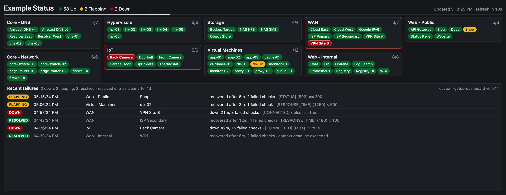

[](https://github.com/ibehren1/custom-gatus-dashboard/releases/latest)
[](https://github.com/ibehren1/custom-gatus-dashboard/actions/workflows/image.yml)
[](LICENSE)
[](go.mod)

# custom-gatus-dashboard

A compact, wall-display style dashboard for [Gatus](https://github.com/TwiN/gatus).
Every endpoint is a small color-coded pill, grouped by Gatus group, and the page
automatically scales so everything fits on one screen without scrolling.
Clicking a pill opens the standard Gatus endpoint detail page.



<sub>Screenshot uses demo data.</sub>

It runs as a sidecar container next to Gatus. It reads data from the Gatus REST API
(no database access) and reverse-proxies the rest of the Gatus UI, so the dashboard
and the Gatus detail pages share one origin.

## Pill colors

| Color  | State    | Meaning                                                   |
|--------|----------|-----------------------------------------------------------|
| Green  | Up       | All recent checks succeeded                               |
| Yellow | Flapping | Latest check succeeded, but a recent check failed         |
| Red    | Down     | Latest check failed (also bold with an outline)           |
| Gray   | No data  | No results recorded yet                                   |

A thin silver bar under the header fills until the next refresh, next to a seconds
countdown. "Recent" means the last `HISTORY_SIZE` results. Hover a pill for the full name,
last response time, last check time, recent history, and errors.

Pill labels use the part of the endpoint name before the first ` - `
(for example `Proxmox pve04 - tcp://pve04.iac.lan:22` shows as `Proxmox pve04`).

## Recent failures

A panel across the bottom lists failure incidents. Consecutive failed checks for an
endpoint are grouped into one incident showing when it started, how long it lasted,
how many checks failed, and why (errors or failed conditions). Each incident is
tagged to match the pill colors:

- **Down** (red): the endpoint is still failing.
- **Flapping** (yellow): the endpoint recovered but its pill is still yellow.
- **Resolved** (green): the endpoint has been healthy since.

Incidents are sorted most recent first, by when the endpoint went down or, if it
has recovered, when it recovered. The time column shows that same time.
Resolved and flapping incidents clear from the list `FAILURE_RETENTION` after they
recovered. When the list is taller than the panel it scrolls upward continuously;
hover to pause.

The dashboard polls Gatus in the background and keeps the incident log in memory.
On startup it backfills from the last 100 results Gatus has for each endpoint.

## Routes

| Path                 | Served by                                    |
|----------------------|----------------------------------------------|
| `/`                  | Dashboard                                    |
| `/dash/static/*`     | Dashboard assets                             |
| `/dash/api/summary`  | Dashboard JSON (pills and failure incidents) |
| `/dash/healthz`      | Health check                                 |
| everything else      | Reverse-proxied to Gatus (detail pages, API) |

Loading the dashboard sets the Gatus `theme` cookie, so endpoint detail pages
opened from a pill or failure row use the same dark theme.

## Configuration

| Variable          | Default             | Description                                         |
|-------------------|---------------------|-----------------------------------------------------|
| `GATUS_URL`       | `http://gatus:8080` | Internal URL of the Gatus container                 |
| `LISTEN_ADDR`     | `:8080`             | Address the dashboard listens on                    |
| `REFRESH_SECONDS` | `15`                | Browser refresh interval                            |
| `POLL_SECONDS`    | `10`                | How often the dashboard polls Gatus                 |
| `HISTORY_SIZE`    | `10`                | Number of recent results used for flap detection    |
| `FAILURE_LOG_SIZE`| `100`               | Maximum resolved incidents kept in the failure log  |
| `FAILURE_RETENTION`| `24h`              | How long recovered incidents stay listed (Go duration, e.g. `30m`, `2h`) |
| `GATUS_THEME`     | `dark`              | Gatus UI theme set when the dashboard loads (`dark`, `light`, or `none` to leave it alone) |
| `TITLE`           | Gatus `ui.title`    | Page title; defaults to the title configured in Gatus |

## Deploy

See [`docker-compose.example.yml`](docker-compose.example.yml). Minimal sidecar service:

```yaml
  dashboard:
    image: ghcr.io/ibehren1/custom-gatus-dashboard:latest
    pull_policy: always
    environment:
      - GATUS_URL=http://gatus:8080
    ports:
      - "8083:8080"
    networks:
      - gatus-network
    read_only: true
```

## Development

```sh
go test ./...
docker build -t custom-gatus-dashboard .
```

## Releases

Every push to `main` runs tests, builds a multi-arch (amd64, arm64) image, and
publishes `ghcr.io/ibehren1/custom-gatus-dashboard` as `:latest` and `:<VERSION>`.
If no release exists yet for that version, CI also creates a GitHub release
`v<VERSION>` with generated notes. Pull requests only build and test.

## License

[MIT](LICENSE) © Isaac B. Behrens
